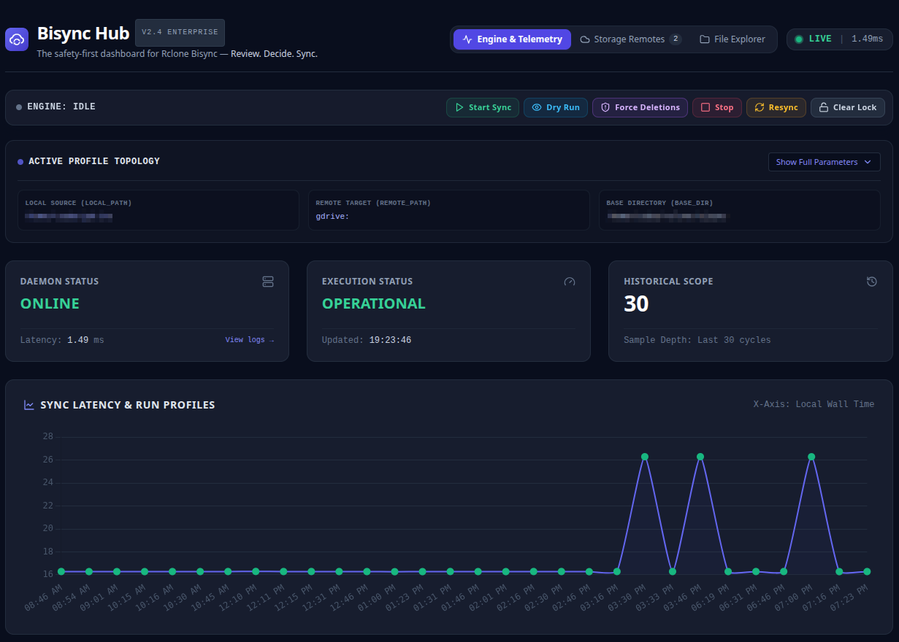
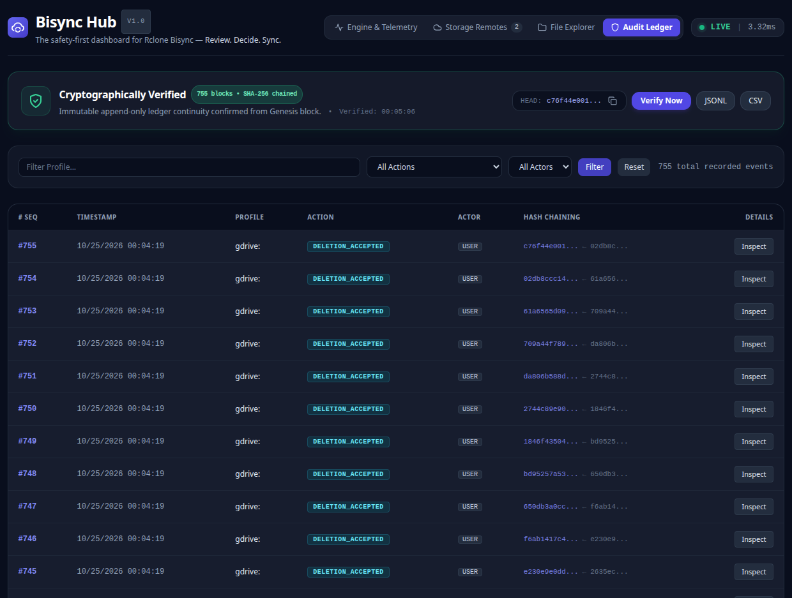
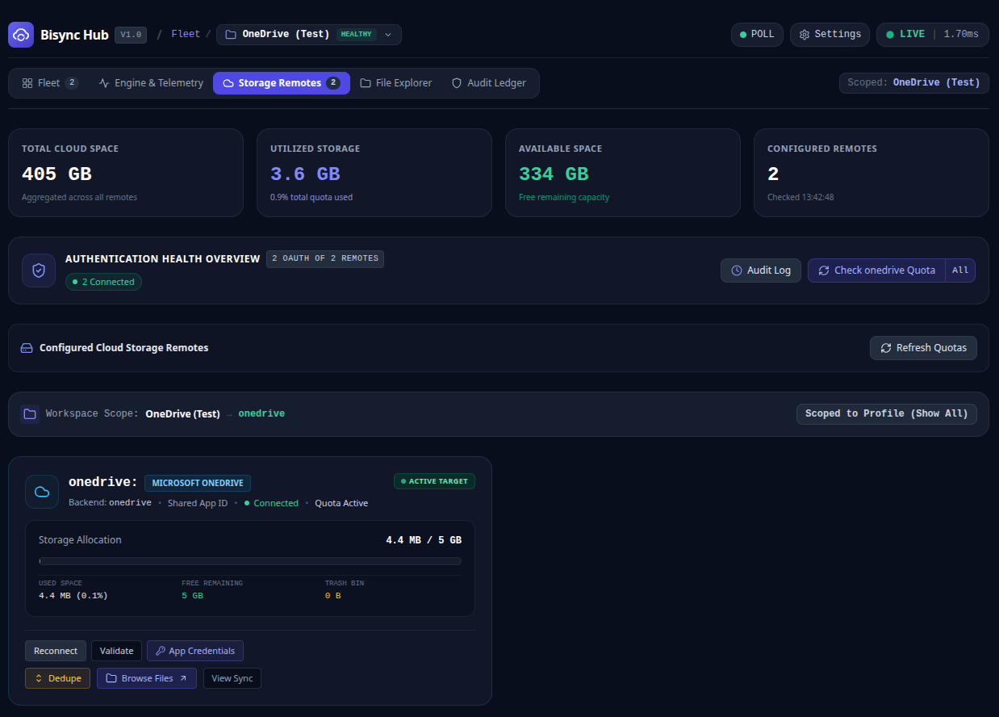

# Bisync Hub

> Review. Decide. Sync.

**Bisync Hub adds conflict analysis, deletion review, recovery workflows, and safety controls to Rclone Bisync.**


Rclone Bisync is one of the most powerful synchronization engines available, but understanding conflicts, mass deletion proposals, and recovery scenarios can quickly become challenging.

Bisync Hub helps users understand synchronization outcomes **before** changes are applied.

Instead of relying on raw logs, terminal output, and post-incident investigation, Bisync Hub provides visibility, human-in-the-loop review workflows, and guided decision support around the synchronization process.

Built as a self-contained Go application, Bisync Hub integrates directly with the Rclone Remote Control (RC) API and is accessible through a local web cockpit:

**http://localhost:8080**

---

# Why Bisync Hub?

When synchronization becomes complex, users are often left asking:

- Why is this file in conflict?
- Why are these files being deleted?
- What changed since the last sync?
- Is it safe to continue?
- How do I recover safely without data loss?

Most tools help execute a synchronization.

**Bisync Hub helps users understand and control a synchronization.**

---

# How Bisync Hub Differs

| Capability | Automation Scripts | Bisync Managers | File Managers | Bisync Hub |
|:---|:---:|:---:|:---:|:---:|
| Scheduled Synchronization | ✅ | ✅ | ⚠️ | ✅ |
| Real-Time Engine Telemetry | ⚠️ | ⚠️ | ❌ | ✅ |
| Fleet Health Overview | ❌ | ⚠️ | ❌ | ✅ |
| Conflict Analysis & Heuristics | ❌ | ❌ | ⚠️ | ✅ |
| Interactive Deletion Review | ❌ | ❌ | ❌ | ✅ |
| Per-File Resolution Decisions | ❌ | ❌ | ❌ | ✅ |
| WAL Crash-Resilient Rollback | ❌ | ❌ | ❌ | ✅ |
| Cryptographic Audit Ledger | ❌ | ❌ | ❌ | ✅ |
| Local Filesystem Jail Confinement | ❌ | ❌ | ❌ | ✅ |

---

# Core Principles

- **Visibility Before Action**: Understand exactly what will happen before mutations run.
- **Safety Before Automation**: Automation should never come at the cost of accidental data loss.
- **Recovery Before Rebuild**: When synchronization encounters conflicts, recovery is guided and reversible.
- **Operational Clarity**: State, remote health, conflicts, and risks are visible without parsing raw log files.

---

# Key Capabilities

## 🛡️ Sync Review & Decision Support
Understand proposed changes before they touch your files:
- Interactive Write-Ahead Log (WAL) review engine ([ADR-008](docs/architecture/adr/ADR-008-WAL-Resilient-Interactive-Conflict-Review.md)).
- Multi-analyzer heuristic conflict scoring (timestamps, size, content hash).
- Pre-mutation backup staging (`.review_backups/`) and atomic commit/rollback.

## ⚡ Operational Visibility & Fleet Management
Monitor synchronization activity and workload health in real time:
- Fleet overview grid with real-time health badges ([ADR-010](docs/architecture/adr/ADR-010-Zero-Build-Design-System-And-Responsive-Telemetry.md)).
- Multi-profile workload isolation with POSIX advisory locks ([ADR-001](docs/architecture/adr/ADR-001-Profiles-As-Primary-User-Object.md)).
- Live transfer speed velocity, progress gauges, and correlated log stream folding.

## 🔒 Safety Controls & Circuit Breakers
Protect your data from unintended deletions or broken mounts:
- Canary validation tokens (`RCLONE_TEST`) preventing sync on unmounted remotes ([ADR-006](docs/architecture/adr/ADR-006-Multi-Layered-Safety-Circuit-Breakers.md)).
- Configurable deletion threshold guardrails (`MaxDeletePercentage`, `MaxDeleteCount`).
- Local filesystem jail confinement strictly restricting directory traversal.

## 📜 Cryptographic Audit Ledger
Maintain a verifiable, tamper-evident history of sync operations:
- Append-only SQLite ledger with trigger-enforced immutability ([ADR-004](docs/architecture/adr/ADR-004-Immutable-Audit-Ledger.md)).
- SHA-256 block hash chaining and browser-based cryptographic integrity verification.
- Compliance audit exports to CSV and JSONL formats.

---

# Screenshots

### Synchronization Review & Conflict Resolution


### Engine Cockpit & Telemetry


### Cryptographic Audit Ledger


### Cloud Storage Remotes & OAuth Management


---

# Architecture & Design

Bisync Hub follows a modular, local-first single-binary Go architecture:

- **[Architecture Decision Records (ADRs)](docs/architecture/adr/README.md)**: Master registry capturing architectural invariants and trade-offs.
- **[Design Specifications](docs/design/README.md)**: Comprehensive technical specs covering the UI design system, operational flags, review engine, and safety policies.

---

# Quickstart & Installation

The application compiles into a self-contained single binary with no external runtime dependencies.

```bash
# Clone the repository
git clone https://github.com/csaba/rclone-bisync.git
cd rclone-bisync

# Run the installer
sudo bash deploy/install.sh
```

Launch the cockpit:

```bash
./bin/rclone-bisync dashboard
```

Then open your browser at:

```text
http://localhost:8080
```

---

# Development Quality Gate

Every contribution must pass the comprehensive 6-stage automated quality gate:

- Formatting and syntax validation (`gofmt`, `go vet`)
- Secret scanning (`betterleaks`)
- Template AST validation
- Full test suite execution with race detection
- LOC ceiling enforcement (<=400 LOC per file)
- Cross-platform build verification

Run the full validation suite:

```bash
./scripts/check.sh all
```

---

# What Bisync Hub Is Not

Bisync Hub is not:
- A replacement for Rclone
- A cloud storage provider or hosted SaaS platform
- A generic cloud file manager
- A competitor to storage platforms

Bisync Hub complements Rclone Bisync by elevating the operational experience, safety, and recovery around file synchronization.

---

# Transparency on AI-Assisted Development

AI tools are used to accelerate implementation, testing, documentation, architecture reviews, and maintenance tasks. All project decisions, reviews, and releases remain under maintainer control.

For details, see [AI_DISCLOSURE.md](./AI_DISCLOSURE.md).

---

# Acknowledgements

Bisync Hub integrates with and builds upon **Rclone**, the open-source cloud storage synchronization and file transfer tool created by Nick Craig-Wood and maintained by the Rclone community. Rclone is distributed under the MIT License.

Bisync Hub is an independent project and is not affiliated with or endorsed by the Rclone project.

---

**Review. Decide. Sync.**
