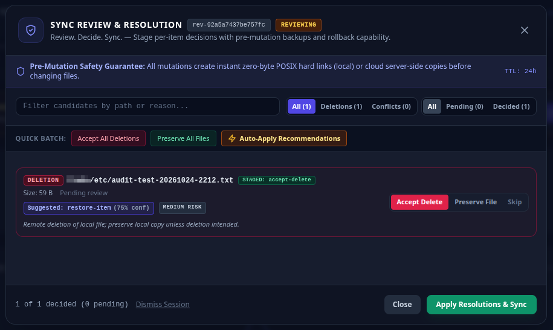

# Bisync Hub

> Review. Decide. Sync.

**Bisync Hub is a safety-first operational platform for Rclone Bisync.**



Most synchronization tools focus on executing sync jobs.

Bisync Hub focuses on helping users understand synchronization outcomes before data changes occur.

Instead of relying on logs, terminal output, and recovery procedures after something goes wrong, Bisync Hub aims to provide visibility, review workflows, and guided decision-making before synchronization is executed.

Bisync Hub provides automated, bidirectional synchronization between your local machine and cloud storage using the **Rclone Remote Control (RC) API**, paired with a single-binary native Go operational dashboard and synchronization orchestrator.

The project focuses on making Rclone Bisync easier to understand, operate, and recover when synchronization becomes complex.

For more screenshots check [here](site/assets/images/screenshots)

---

# Why Bisync Hub?

Rclone is one of the most powerful file synchronization tools available.

However, when synchronization becomes complex, users are often left answering difficult questions:

- Why is this file in conflict?
- Why is Bisync trying to delete these files?
- What changed since the previous sync?
- Is it safe to continue?
- How do I recover from a failed synchronization?

Bisync Hub exists to answer those questions.

Instead of exposing users to raw logs and force flags, Bisync Hub aims to provide operational visibility, safety controls, and synchronization intelligence.

---

# How Bisync Hub Differs

Bisync Hub is inspired by the Rclone ecosystem and benefits from lessons learned across existing synchronization tools and automation projects.

While many projects help users run, schedule, or automate synchronizations, Bisync Hub focuses on helping users understand synchronization outcomes before changes occur.

## Comparison at a Glance

| Capability | Sync Scripts | Bisync Managers | File Managers | Bisync Hub |
|------------|-------------|----------------|---------------|------------|
| Run Rclone Bisync | ✅ | ✅ | ✅ | ✅ |
| Scheduled Synchronization | ✅ | ✅ | ⚠️ | ✅ |
| Systemd Integration | ✅ | ✅ | ❌ | ✅ |
| Operational Dashboard | ❌ | ⚠️ | ✅ | ✅ |
| Real-Time Telemetry | ❌ | ⚠️ | ⚠️ | ✅ |
| Authentication Health Monitoring | ❌ | ❌ | ❌ | ✅ |
| Synchronization Visibility | ⚠️ | ⚠️ | ❌ | ✅ |
| Conflict Review Experience | ❌ | ❌ | ⚠️ | ✅ |
| Deletion Review Workflow | ❌ | ❌ | ❌ | ✅ |
| Guided Recovery Workflows | ❌ | ❌ | ❌ | ✅ |
| Per-File Sync Decisions | ❌ | ❌ | ❌ | ✅ |
| Rollback-Oriented Design | ❌ | ❌ | ❌ | ✅ |
| Cryptographic Audit Ledger | ❌ | ❌ | ❌ | ✅ |

## Existing Approaches

### Synchronization Automation

Many synchronization projects focus on:

- Running scheduled synchronizations
- Managing system timers
- Applying recommended safety flags
- Capturing logs and errors

These tools make synchronization easier to automate.

### Synchronization Management

Some projects expand automation with:

- Multiple synchronization profiles
- Scheduling
- Background daemons
- Configuration management
- Tray integration

These tools make synchronization easier to operate.

### File Management

Many graphical Rclone frontends focus on:

- Browsing files
- Managing cloud storage
- Copying and moving data
- Exploring remotes

These tools make storage easier to navigate.

## The Bisync Hub Approach

Bisync Hub focuses on a different question:

> How can users understand the impact of a synchronization before data changes occur?

The project is being built around the concept of **synchronization intelligence**, not simply synchronization execution.

Future workflows are intended to help answer questions such as:

- Why is this file in conflict?
- Why is a deletion being proposed?
- What changed since the previous sync?
- What will happen if synchronization proceeds?
- Which files require user attention?
- How can a failed synchronization be recovered safely?

Most synchronization tools help execute a sync.

**Bisync Hub aims to help users understand a sync.**

---

# Not Another File Manager

Many Rclone-based tools focus on:

- File browsing
- File transfers
- Cloud storage management
- Remote administration

Bisync Hub focuses on a different problem:

**Synchronization Intelligence**

The goal is not simply to execute a synchronization.

The goal is to help users understand, review, and control synchronization outcomes.

The integrated file explorer exists to provide synchronization context, not to become a full-featured cloud file manager.

---

# Core Principles

## Visibility Before Action

Users should understand what will happen before synchronization runs.

## Safety Before Automation

Automation should not come at the cost of accidental data loss.

## Recovery Before Rebuild

When synchronization fails, recovery should be guided and understandable.

## Operational Clarity

Synchronization state, remote health, conflicts, and risks should be visible without reading log files.

---

# Current Capabilities

- Real-time synchronization telemetry and speed velocity charts
- Browser-based operational dashboard with 4 core views
- Embedded single-page application UI (zero-dependency, compiled-in)
- Native Go single-binary deployment with sub-30MB footprint
- Multi-profile workload management with isolated background schedulers and POSIX lock confinement (`/tmp/rclone-bisync-<id>.lock`)
- 3-tier operational flags architecture (`Execution Override > Profile Override > Global Default > Hardcoded Fallback`) with POSIX shell tokenizer and prohibited flags security blocklist
- Hybrid Fleet Overview dashboard with aggregate health summary banner and interactive profile tile grid
- Contextual profile workspace with global header profile switcher dropdown and breadcrumb navigation
- Visual 3-tier flags editor with live inheritance badges and client-side security validation
- Integrated dual-pane local and remote file explorer
- OAuth connection health monitoring and guided renewal modals
- Authentication recovery workflows for Google Drive and OneDrive
- Canary validation (`RCLONE_TEST`) and filesystem jail confinement
- Interactive sync review modal with per-file triage and heuristic recommendations
- Multi-analyzer heuristic conflict engine (size divergence, binary signatures, cloud clock skew, edit velocity)
- Atomic pre-mutation backups (`.review_backups/`) and automated post-review sync execution
- Cryptographic Immutable Audit Ledger with trigger-enforced SQLite append-only storage
- Verifiable SHA-256 hash chaining and in-browser cryptographic integrity verification
- Compliance export to CSV and JSONL formats
- In-process POSIX size-bounded log rotator with dual-stream audit logging (`bisync.log`)
- High-performance Go CLI quality gate (`cmd/check`) with parallel check runners and true HTML attribute tokenization
- Headless Chrome end-to-end smoke testing (`chromedp`)
- Decoupled, single-responsibility Go service architecture with strict LOC budgets (<=400 LOC per file)
- Synchronization orchestration and scheduling
- Systemd integration with real-time journal log streaming
- Safety-focused execution controls and circuit breakers
- Remote health monitoring and structured diagnostics

---

# Future Vision

## Review. Decide. Sync.

The long-term vision is to transform synchronization from a command into a reviewable workflow.

```text
Scan
 ↓
Analyze
 ↓
Review Changes
 ↓
Review Conflicts
 ↓
Review Deletions
 ↓
Make Decisions
 ↓
Execute Synchronization
 ↓
Recover if Required
```

Rather than investigating problems after synchronization has completed, users should be able to understand and influence synchronization outcomes beforehand.

---

# Planned Capabilities

## Multi-Profile Synchronization

Manage multiple independent synchronization environments from a single operational hub:

- Personal Google Drive, Business OneDrive, NAS archive, and remote cloud pairings
- Isolated per-profile background runners with dedicated state and POSIX flock management
- Profile-aware telemetry streams, speed metrics, and file explorer views

## Visual Configuration & Setup Manager

Provide safe, in-dashboard editing of sync flags and onboarding setup:

- In-dashboard tuning of sync flags (`--buffer-size`, `--tpslimit`, `--transfers`)
- Guided visual setup wizard for initial Rclone RC remote pairing
- 3-layer safety pipeline with snapshot backups, SHA-256 integrity verification, and schema checks
- One-click rollback API to restore historical configurations

## In-App User Guidance & Guided Recovery

Enhance operational clarity and assisted recovery directly within the UI:

- Inline contextual tooltips and policy banners explaining safety triggers in plain language
- Slide-over reference manual for CLI commands, sync flags, and conflict recovery steps
- Step-by-step diagnostic workflows for OAuth drops, permission errors, and service halts

## Remote Mount Lifecycle Manager & Storage Pooling

Turn fragile cloud connections into resilient, self-healing virtual storage endpoints:

- Background daemon managing `rclone mount` lifecycles on Linux (FUSE) and Windows (WinFsp)
- Multi-cloud storage pooling (`union` + `chunker` + `crypt`) over RC APIs
- Automatic keepalive health probes and clean unmount handlers (`fusermount -u`)

---

# Core Components

## 1. Rclone Daemon

`rclone-daemon.service`

Background controller exposing internal statistics and control APIs.

## 2. Telemetry UI Backend

`rclone-dashboard.service`

Native Go web server running the embedded Alpine.js and Tailwind UI.

Responsibilities:

- Real-time telemetry
- State aggregation
- Log streaming
- Dashboard APIs

## 3. Synchronization Engine

`bisync-gdrive.service`

Native Go synchronization runner.

Responsibilities:

- Safe execution
- Canary validation
- Lock management
- Synchronization orchestration

## 4. OAuth Connection Manager

Provides:

- Authentication health monitoring
- OAuth reconnect workflows
- Credential validation
- Audit history

## 5. Systemd Timer

`bisync-gdrive.timer`

Automatically executes periodic synchronization cycles.

---

# Installation

The application compiles into a self-contained single-binary executable with no Python runtime dependencies.

## Install

```bash
sudo bash deploy/install.sh
```

---

# CLI Commands

```bash
# Launch dashboard
./bin/rclone-bisync dashboard

# Execute synchronization
./bin/rclone-bisync sync

# Force resync
./bin/rclone-bisync sync --resync

# Dry-run synchronization
./bin/rclone-bisync sync --dry-run

# Provision canary
./bin/rclone-bisync canary
```

---

# Accessing Bisync Hub

Preferred user experience:

```text
bisync-hub dashboard
        ↓
Browser Opens
        ↓
Bisync Hub Dashboard
```

Future releases may provide:

```text
http://bisync.localhost
```

as a stable local endpoint while maintaining automatic port management internally.

---

# Development

Run the pre-flight quality gate before opening a pull request.

Bisync Hub includes a high-performance Go-based quality engine (`cmd/check`) wrapped by `./scripts/check.sh`:

```bash
# Run all quality gate stages
./scripts/check.sh all

# Or invoke the Go check engine directly
go run ./cmd/check all

# Run specific stages
go run ./cmd/check fmt        # Code formatting (gofmt) & shell script validation
go run ./cmd/check templates  # HTML attribute tokenization & Alpine boolean audits
go run ./cmd/check loc 400    # Code metrics & per-file LOC budget enforcement
go run ./cmd/check lint       # Linters (go vet, betterleaks, staticcheck, govulncheck)
go run ./cmd/check test       # Unit tests with race detector & coverage validation (>80%)
go run ./cmd/check build      # Compilation & cross-builds (linux/amd64, linux/arm64)
```

The quality gate automatically validates:

1. **Formatting & Syntax**: Strict Go source formatting and POSIX shell script syntax (`bash -n`)
2. **Template Attributes**: Multi-line HTML attribute tokenization preventing Alpine.js boolean coercion bugs
3. **Architecture & LOC**: Structural line-count audit ensuring Go files stay under ~400 LOC
4. **Security & Linters**: Deep secret scanning via `betterleaks`, vulnerability checks via `govulncheck`, and `go vet`
5. **Test Coverage**: Automated test execution verifying >80% statement coverage across all packages
6. **Cross-Compilation**: Clean binary artifact generation across target architectures

---

# Roadmap Priorities

## Near-Term Strategic Priorities

- **Priority 1: Multi-Profile Workspace Manager**: Independent synchronization profiles, isolated goroutine runners, dedicated POSIX lock and state isolation
- **Priority 2: Visual Configuration & Setup Manager**: In-dashboard tuning of sync flags (`--buffer-size`, `--tpslimit`), guided remote onboarding wizard, 3-layer safety pipeline, and one-click rollback
- **Priority 3: In-App User Guidance & Diagnostic Manual**: Contextual tooltips, plain-language safety banners, slide-over reference manual, and guided troubleshooting workflows
- **Priority 4: Remote Mount Lifecycle Manager & Storage Pooling**: Programmatic FUSE/WinFsp mount management, keepalive probes, and multi-cloud virtual drive pooling (`union` + `chunker` + `crypt`)

## Medium-Term

- Multi-channel webhook alerts (Discord, Telegram, Healthchecks.io dead-man snitch pings)
- Provider-specific optimizations (Google Drive change-polling, OneDrive 2-second timestamp window smoothing)
- Guided assisted resynchronization and recovery checkpoints

## Long-Term

- Peer-to-peer state coordination across distributed branch nodes
- Encrypted remote telemetry synchronization
- Desktop application packaging via Wails

---

# What Bisync Hub Is Not

Bisync Hub is not:

- A replacement for Rclone
- A cloud storage provider
- A hosted SaaS platform
- A generic cloud file manager
- A competitor to storage providers

Bisync Hub exists to improve the operational experience surrounding Rclone Bisync.

---

# Transparency on AI-Assisted Development

AI tools are used to accelerate:

- Implementation
- Testing
- Documentation
- Architecture reviews
- Maintenance tasks

All project decisions, reviews, and releases remain under maintainer control.

For details, see: [AI DISCLOSURE](./AI_DISCLOSURE.md)

---

# Acknowledgements

Bisync Hub integrates with and depends on **Rclone**, the open-source cloud storage synchronization and file transfer tool created by Nick Craig-Wood and maintained by the Rclone community.

Rclone is distributed under the MIT License.

Bisync Hub is an independent project and is not affiliated with or endorsed by the Rclone project.

---

**Review. Decide. Sync.**
