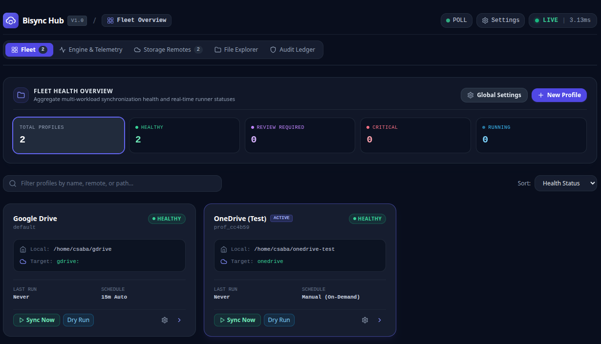

# Bisync Hub

> Review. Decide. Sync.

**Bisync Hub adds conflict analysis, deletion review, recovery workflows, and safety controls to Rclone Bisync.**


Rclone Bisync is one of the most powerful synchronization tools available, but understanding conflicts, deletion proposals, and recovery scenarios can quickly become challenging.

Bisync Hub helps users understand synchronization outcomes before changes are applied.

Instead of relying on logs, terminal output, and post-incident investigation, Bisync Hub provides visibility, review workflows, and decision support around the synchronization process.

Built as a self-contained Go application, Bisync Hub integrates with the Rclone Remote Control (RC) API and is accessible through a local web interface:

**http://localhost:8080**

---

# Why Bisync Hub?

When synchronization becomes complex, users are often left asking:

- Why is this file in conflict?
- Why are these files being deleted?
- What changed since the last sync?
- Is it safe to continue?
- How do I recover safely?

Most tools help execute a synchronization.

**Bisync Hub helps users understand a synchronization.**

---

# How Bisync Hub Differs

| Capability | Automation Tools | File Managers | Bisync Hub |
|------------|-----------------|---------------|------------|
| Scheduled Synchronization | ✅ | ⚠️ | ✅ |
| File Browsing | ❌ | ✅ | ✅ |
| Synchronization Visibility | ⚠️ | ❌ | ✅ |
| Conflict Review | ❌ | ⚠️ | ✅ |
| Deletion Review | ❌ | ❌ | ✅ |
| Per-File Decisions | ❌ | ❌ | ✅ |
| Guided Recovery | ❌ | ❌ | ✅ |
| Audit History | ❌ | ❌ | ✅ |

---

# Core Principles

## Visibility Before Action

Users should understand what will happen before synchronization runs.

## Safety Before Automation

Automation should never come at the cost of accidental data loss.

## Recovery Before Rebuild

When synchronization fails, recovery should be guided and understandable.

## Operational Clarity

Synchronization state, remote health, conflicts, and risks should be visible without reading log files.

---

# Capabilities

## Sync Review & Decision Support

Understand proposed changes before they are executed.

- Conflict analysis
- Deletion review
- Per-file decisions
- Heuristic recommendations
- Interactive review workflows

## Operational Visibility

Monitor synchronization activity and health in real time.

- Fleet overview
- Synchronization telemetry
- Log streaming
- Authentication health monitoring
- Remote diagnostics

## Safety & Recovery

Reduce the risk of accidental data loss.

- Canary validation
- Safety controls and circuit breakers
- Atomic backups
- Guided recovery workflows
- Synchronization health checks

## Multi-Profile Management

Operate multiple synchronization workloads from a single interface.

- Profile isolation
- Background scheduling
- Per-profile configuration
- Independent execution controls
- Remote health tracking

## Audit & Compliance

Maintain a verifiable history of synchronization activity.

- Immutable audit ledger
- SHA-256 integrity verification
- Audit exports
- Synchronization history
- Traceable operational decisions

---

# Screenshots

## Synchronization Review


## Fleet Overview



## Telemetry & Operational Visibility


## Profile Management


---

# Vision

## Review. Decide. Sync.

The long-term vision is to transform synchronization from a command into a reviewable workflow.

```text
Scan
 ↓
Analyze
 ↓
Review Changes
 ↓
Review Conflicts
 ↓
Review Deletions
 ↓
Make Decisions
 ↓
Execute Synchronization
 ↓
Recover if Required
```

Rather than investigating problems after synchronization has completed, users should be able to understand and influence synchronization outcomes beforehand.

---

# Roadmap

## Near Term

- Multi-Profile Workspace Manager
- Visual Configuration & Setup Manager
- In-App Guidance & Diagnostic Manual
- Remote Mount Lifecycle Manager

## Medium Term

- Multi-channel notifications
- Provider-specific optimizations
- Assisted recovery workflows

## Long Term

- Distributed state coordination
- Remote telemetry synchronization
- Desktop application packaging

---

# Installation

The application compiles into a self-contained single binary with no external runtime dependencies.

```bash
sudo bash deploy/install.sh
```

After installation:

```bash
./bin/rclone-bisync dashboard
```

Then open:

```text
http://localhost:8080
```

---

# Development Quality

Every contribution passes an automated quality gate covering:

- Formatting and syntax validation
- Security and secret scanning
- Vulnerability analysis
- Test execution and coverage validation
- Architecture and code-size rules
- Cross-platform build verification

Run the full validation suite:

```bash
./scripts/check.sh all
```

The quality gate helps maintain code quality, operational safety, and long-term maintainability without introducing excessive process overhead.

---

# What Bisync Hub Is Not

Bisync Hub is not:

- A replacement for Rclone
- A cloud storage provider
- A hosted SaaS platform
- A generic file manager
- A competitor to storage platforms

Bisync Hub complements Rclone Bisync by improving the operational experience surrounding synchronization.

---

# Transparency on AI-Assisted Development

AI tools are used to assist with implementation, testing, documentation, architecture reviews, and maintenance tasks.

All project decisions, reviews, and releases remain under maintainer control.

For details, see [AI_DISCLOSURE.md](./AI_DISCLOSURE.md).

---

# Acknowledgements

Bisync Hub integrates with and depends on **Rclone**, the open-source cloud storage synchronization and file transfer tool created by Nick Craig-Wood and maintained by the Rclone community.

Bisync Hub is an independent project and is not affiliated with or endorsed by the Rclone project.

---

**Review. Decide. Sync.**
